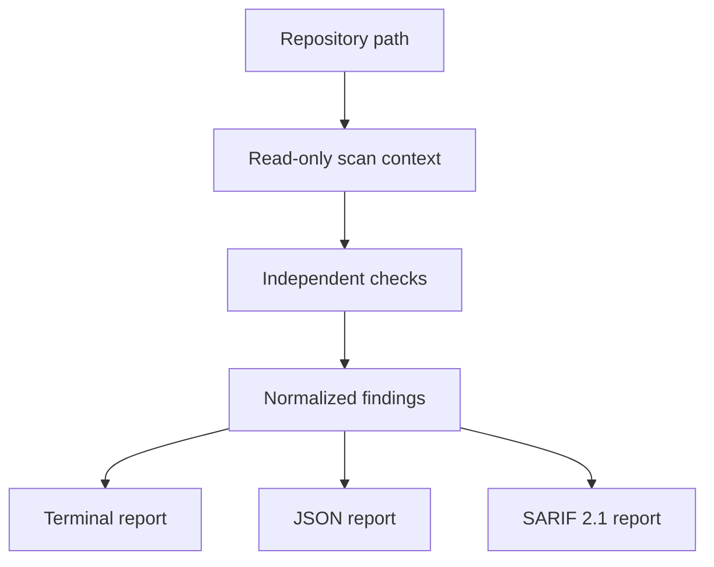

<div align="center">

# 🛡️ ForgeGuard

### Secure repositories. Explain risks. Ship with confidence.

**A fast, local-first security and health scanner for modern software repositories.**

[](https://github.com/Rohit-kumar-2674/forgeguard/actions/workflows/ci.yml)
[](https://www.python.org/)
[](LICENSE)
[](https://docs.oasis-open.org/sarif/sarif/v2.1.0/)
[](pyproject.toml)

[Get started](#-quick-start) · [Explore features](#-what-forgeguard-finds) · [Configure](#%EF%B8%8F-configuration) · [Contribute](#-help-build-forgeguard)

</div>

---

ForgeGuard turns repository security signals into findings people can actually act on. Run one
command to inspect documentation, dependency hygiene, GitHub Actions, and potential credentials—
without executing the target project, uploading its source, or exposing matched secrets.

Read [scan scope and reliable automation](docs/RELIABILITY.md) for file limits, configuration validation, exit codes, and SARIF portability. The CLI also supports `python -m forgeguard`.

```console
$ forgeguard scan .

ForgeGuard Repository Report
==============================
Path:   /workspace/example
Score:  91/100
Checks: 4  Files: 42  Findings: 2

[MEDIUM] FG-ACT-001: Third-party action is not pinned to a commit
  actions/checkout uses a mutable reference.
  Fix: Pin the action to a reviewed 40-character commit SHA.
```

> [!IMPORTANT]
> ForgeGuard is an early alpha and a review aid—not proof that a repository is secure. Findings
> should be evaluated by a human, especially before changing production security controls.

## ✨ Why ForgeGuard?

| Principle | What it means in practice |
|---|---|
| **Local first** | Repository contents stay on your machine. There is no telemetry or hidden upload. |
| **Safe by design** | ForgeGuard reads untrusted files but never executes the repository's code. |
| **Explainable** | Every finding has a stable ID, severity, evidence, remediation, and reference when available. |
| **Secret conscious** | Potential credentials are redacted before they reach terminal, JSON, or SARIF output. |
| **Automation ready** | Deterministic fingerprints and exit thresholds make results useful in CI. |
| **Portable** | The scanner uses only Python's standard library at runtime and supports Python 3.10+. |

## 🔎 What ForgeGuard finds

| Area | Current checks | Status |
|---|---|:---:|
| Repository health | Missing `README.md`, `LICENSE`, `SECURITY.md`, and `CONTRIBUTING.md` | ✅ |
| GitHub Actions | `permissions: write-all` and third-party actions using mutable references | ✅ |
| Secrets | Private-key headers, AWS access keys, and GitHub token patterns—with redaction | ✅ |
| Dependencies | Missing recognized lockfiles for Python and JavaScript projects | ✅ |
| Reporting | Terminal, JSON, SARIF 2.1, stable fingerprints, and severity exit codes | ✅ |
| Vulnerability intelligence | Authoritative OSV-backed dependency analysis | 🗺️ Planned |
| Supply chain | SPDX and CycloneDX SBOM generation | 🗺️ Planned |

ForgeGuard deliberately prefers a small set of trustworthy checks over a huge catalog of shallow
or fabricated warnings. See the [roadmap](ROADMAP.md) for what comes next.

## ⚡ Quick start

### Requirements

- Python **3.10 or newer**
- Git, if installing directly from GitHub

### Install from GitHub

```bash
python -m pip install "git+https://github.com/Rohit-kumar-2674/forgeguard.git"
forgeguard --version
```

### Install for development

```bash
git clone https://github.com/Rohit-kumar-2674/forgeguard.git
cd forgeguard
python -m venv .venv
```

Activate the environment:

```bash
# Linux, macOS, Termux, WSL
source .venv/bin/activate

# Windows PowerShell
.venv\Scripts\Activate.ps1
```

Then install ForgeGuard:

```bash
python -m pip install -e .
forgeguard scan .
```

## 🚀 Command recipes

```bash
# Human-readable report
forgeguard scan /path/to/repository

# Machine-readable JSON
forgeguard scan . --format json > forgeguard-report.json

# SARIF 2.1 for code-scanning integrations
forgeguard scan . --format sarif > forgeguard.sarif

# Return exit code 1 when a high or critical finding exists
forgeguard scan . --fail-on high

# Temporarily suppress a check
forgeguard scan . --ignore FG-DOC-001

# Load a specific configuration
forgeguard scan . --config configs/strict.yml
```

### Exit codes

| Code | Meaning |
|:---:|---|
| `0` | Scan completed and the configured failure threshold was not reached. |
| `1` | At least one finding met the configured failure threshold. |
| `2` | The command, repository path, or configuration was invalid. |

## ⚙️ Configuration

ForgeGuard automatically looks for `forgeguard.yml` in the repository being scanned.

```yaml
version: 1

scan:
  documentation: true
  actions: true
  secrets: true
  dependencies: true

thresholds:
  fail_on: high

ignore:
  - FG-DOC-001
```

Unknown keys, unsupported categories, invalid booleans, and unsupported thresholds are rejected
with a clear error. ForgeGuard fails closed instead of silently ignoring configuration mistakes.

## 🧩 How it works



Each check implements one small interface and returns normalized findings. The scanner filters
disabled or ignored checks, calculates an explainable score, and passes the same report model to
every output renderer. This separation keeps new checks testable and prevents presentation logic
from changing scan behavior.

Explore the full [architecture and trust boundaries](ARCHITECTURE.md).

## 🔐 Security and privacy model

ForgeGuard treats every scanned repository as untrusted input.

- It does **not** import or execute target code.
- It does **not** send source files to a hosted service.
- It does **not** collect telemetry.
- It does **not** print complete matched credentials.
- It skips common dependency/build directories and oversized files during secret-pattern scanning.
- Its own GitHub Actions use least-privilege permissions and immutable commit references.

Found a vulnerability in ForgeGuard? Please follow [SECURITY.md](SECURITY.md) and avoid public
disclosure until a fix is available.

## 🧪 Development and quality

```bash
python -m pip install -e ".[dev]"
pytest
ruff check .
```

The test suite covers scanner behavior, redaction, GitHub Actions analysis, configuration
validation, stable fingerprints, CLI exit policy, and SARIF structure. CI runs the suite across
Python 3.10, 3.12, and 3.13.

## 🌍 Platform support

| Platform | Support notes |
|---|---|
| Linux | Native Python installation |
| macOS | Native Python installation |
| Windows | PowerShell, Command Prompt, or WSL |
| Android | Termux or a Python-capable proot environment |
| CI/CD | Any runner with Python 3.10+ |

No Docker daemon, systemd service, Node.js runtime, or architecture-specific binary is required.

## 🛠️ Troubleshooting

<details>
<summary><strong><code>forgeguard: command not found</code></strong></summary>

Confirm the active Python environment and reinstall the package:

```bash
python -m pip install -e .
python -m forgeguard.cli --version
```

If the module command works, ensure your Python scripts directory is present in `PATH`.
</details>

<details>
<summary><strong>PowerShell blocks virtual-environment activation</strong></summary>

You may use the environment without activating it:

```powershell
.venv\Scripts\python.exe -m pip install -e .
.venv\Scripts\forgeguard.exe scan .
```
</details>

<details>
<summary><strong>Configuration is rejected</strong></summary>

Check that `version` is `1`, category values are `true` or `false`, `fail_on` is one of
`none`, `critical`, `high`, `medium`, or `low`, and ignored IDs begin with `FG-`.
</details>

<details>
<summary><strong>A secret finding is a false positive</strong></summary>

Review the redacted evidence first. If the file is safe, suppress the check temporarily with
`--ignore FG-SEC-001` or document the repository-level exception in `forgeguard.yml`. Never paste
the original value into an issue.
</details>

## 🤝 Help build ForgeGuard

ForgeGuard is designed to be understandable by first-time contributors and extensible by security
engineers. Useful contributions include:

- Adding well-tested credential patterns with strong false-positive controls
- Improving workflow permission analysis
- Creating positive and negative scanner fixtures
- Improving Windows, macOS, Linux, and Termux documentation
- Reviewing threat-model or privacy assumptions

Read [CONTRIBUTING.md](CONTRIBUTING.md), browse the
[roadmap](ROADMAP.md), or [open an issue](https://github.com/Rohit-kumar-2674/forgeguard/issues/new/choose).

Please keep contributions focused and legitimate. ForgeGuard will never encourage artificial
downloads, stars, dependents, or meaningless pull requests.

## 📚 Project documents

| Document | Purpose |
|---|---|
| [Architecture](ARCHITECTURE.md) | Components, scoring model, and trust boundaries |
| [Roadmap](ROADMAP.md) | Planned releases and product direction |
| [Contributing](CONTRIBUTING.md) | Local setup and pull-request expectations |
| [Security policy](SECURITY.md) | Responsible vulnerability reporting |
| [Governance](GOVERNANCE.md) | Current decision-making model |
| [Changelog](CHANGELOG.md) | Version history |
| [Code of Conduct](CODE_OF_CONDUCT.md) | Community expectations |

## 📄 License

ForgeGuard is released under the [MIT License](LICENSE).

<div align="center">

Built openly by [Rocky](https://github.com/Rohit-kumar-2674) and future contributors.

**Secure. Maintain. Understand. Ship.**

</div>
